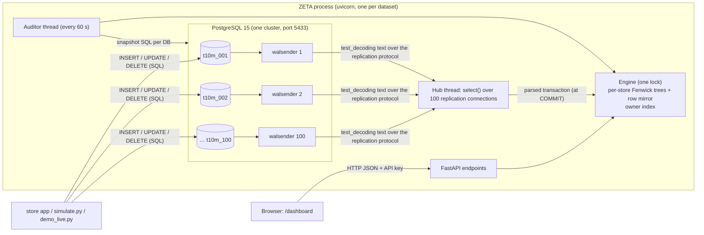

# ZETA — technical write-up of what actually exists

Written 31 Oct 2026, after re-reading every source file in `~/Desktop/hackathon` and re-running the checks.
Repository state: commit `8651f4d`, then updated the same evening after **fixing the isolation leaks found
while writing it** (§7). Line numbers in `zeta/api.py` refer to the code before that fix unless stated.

**How to read the labels.** Every statement carries one of:

- **[V] VERIFIED**: I read the code or ran the command while writing this document.
- **[R] REPORTED**: measured or observed earlier in the build session and not re-checked for this document.
- **[A] ASSUMED**: reasoning or expectation that I did not test.

Code references look like `zeta/engine.py:52-78` (file and line range at commit `8651f4d`).

---

## 1. Overview

### What it does

ZETA is an **aggregation layer**: a program that sits between the stores' databases and the dashboards and
keeps pre-computed totals, so a dashboard question ("how many orders today?") is answered from memory instead
of by scanning millions of rows. Each store (a **tenant**: one customer of the platform, isolated from the
others) has its own PostgreSQL database. ZETA reads every committed change from each database's
**write-ahead log** (WAL: the journal Postgres writes every change to before applying it), updates its
in-memory totals within milliseconds, and answers a REST API for each store and for the one company owner who
owns all stores. It can also prove that its totals match the databases. [V] (`zeta/api.py:1-27`, `zeta/cdc.py:1-5`)

### Project map

| Path | What it is | Label |
|---|---|---|
| `zeta/engine.py` | Core: Fenwick tree class, per-store state (`Tenant`), bootstrap, applying changes, store queries, owner-query fallbacks | [V] |
| `zeta/owner.py` | Owner index: all-store structures for cross-store queries | [V] |
| `zeta/cdc.py` | Change data capture: one `Stream` per store database, the `Hub` thread that reads them all, the WAL text parser | [V] |
| `zeta/api.py` | FastAPI web app: all HTTP endpoints, auth checks, analytics, health, admin | [V] |
| `zeta/audit.py` | Snapshot-exact audit against Postgres, binary-search localization, surgical repair | [V] |
| `zeta/guard.py` | API keys (HMAC) and the cost-based rate limiter | [V] |
| `zeta/dashboard.html` | The one dashboard (Overview, Stores, Explore, Operations tabs), plain HTML/CSS/JS | [V] |
| `store/app.py`, `store/index.html` | Demo "store app" (customer side): browse, place and cancel orders, writes to the store's database | [V] |
| `split_load.py` | Loads the organisers' CSVs as one Postgres database per store | [V] |
| `harness.py` | Correctness harness: random queries vs direct SQL | [V] |
| `test_isolation.py` | Automated tenant-isolation test over every API route (added after this write-up found leaks) | [V] |
| `simulate.py` | Write-traffic generator (inserts, status changes, deletes, item edits, backdates) | [V] |
| `bench.py` | Benchmarks: latency/growth, freshness, DB safety | [V] |
| `demo_live.py` | Scripted judge demo: place and cancel orders, compare with SQL at every step | [V] |
| `run.sh`, `run_store.sh`, `keys.sh` | Start ZETA, start the store app, print keys | [V] |
| `generate_data.py`, `schema.sql`, `load.sql` | The organisers' files, unchanged since the first commit (`git diff 46bce92` is empty) | [V] |
| `load.sh` | Loader for the **old** single-database layout (`zeta`, `zeta10m`); no longer used | [V] |
| `ZETA_DESIGN.md` | Original design note (written before building; parts differ from what was built, see §13) | [V] |
| `README.md` | Run instructions and results | [V] |
| `data_1m/`, `data_10m/` (not in git) | Generated CSVs: 137 MB and 1.4 GB | [V] |
| `pgdata/` (not in git) | The project's own Postgres cluster: 15 GB including WAL | [V] |
| `.venv/` (not in git) | Python virtual environment, 212 MB | [V] |
| `.zeta_secret` (not in git) | Secret that signs all API keys | [V] |

`requirements.txt` (version ranges), `requirements.lock` (exact tested versions) and `setup.sh` (one command) exist;
there is no Dockerfile and no unit-test suite. The automated pass/fail tests are `harness.py` (correctness) and
`test_isolation.py` (isolation). [V]

### How to start it from scratch

```bash
brew install python postgresql@15      # Python 3.11+, PostgreSQL 15+
./setup.sh                             # venv, Postgres cluster with ZETA's settings (§2), .zeta_secret, 1M + 10M datasets
./run.sh t1m 8000 &  ./run.sh t10m 8001 &      # or: ./run_cluster.sh t10m 2 8001  (2 nodes + router)
./keys.sh 1          # prints store 1's key, the owner key and the admin key
```

`setup.sh --small` was run on a clean copy of the repository (no venv, data or secret; Postgres on port 5544): it
finished in 24 s, and a 2-node cluster on that copy passed 600/600 correctness and 239/239 isolation checks. [V]
It has not been tried on Linux or on a machine without Homebrew. [A]

A judge then opens `http://localhost:8001/dashboard?key=<owner key>` and sees the Overview tab (headline
numbers for all 100 stores with change vs the previous period, a trend chart, category mix, status
breakdown, top products, a weekday × hour heatmap), plus Stores, Explore and Operations tabs (§8). [V]

---

## 2. Tech stack

Hardware: Apple M4, 10 cores, 16 GB RAM, macOS 26.6.2. [V] (`sysctl`, `sw_vers`)

| Component | Version | Why it was chosen | Alternative considered |
|---|---|---|---|
| Python | 3.14.6 | Fast to write; numpy makes array maths fast enough | Go or Rust (faster, slower to build in a weekend) |
| numpy | 2.5.4 | All aggregates are integer arrays; vectorized sums and `bincount` (count values per integer key) | pandas (heavier, not needed) |
| pyarrow | 26.0.0 | Fast CSV parsing of Postgres `COPY` output at bootstrap | csv module (10–50× slower) [A] |
| psycopg2-binary | 2.9.13 | The only common Python Postgres driver with **logical replication** support (`LogicalReplicationConnection`) | psycopg 3 (replication support less mature at the time) [A] |
| FastAPI | 0.162.0 (Starlette 1.10.0, pydantic 2.14.2) | Small REST framework, automatic `/docs` page | Flask |
| uvicorn | 0.54.0 (+ uvloop 0.23.0, httptools 0.9.0) | The standard **ASGI** server (the program that accepts HTTP connections for FastAPI) | gunicorn |
| httpx | 0.28.1 | HTTP client for harness, benchmarks, demo | requests |
| PostgreSQL | 15.15 (Homebrew), own cluster on port 5433 | The PRD suggests Postgres; it already has a durable, ordered change log (the WAL) | MongoDB |
| test_decoding | ships with Postgres | **Logical decoding plugin**: turns WAL records into text rows. Nothing to install | wal2json (needed a separate build), pgoutput (binary protocol, more parsing work) |
| Cache | **none** | ZETA's own memory *is* the pre-computed store | Redis (rejected, §13) |
| Front end | plain HTML/CSS/JavaScript, hand-drawn SVG charts, no libraries, no build step | Nothing to install; one file | React + a chart library |
| Node.js | v25.2.1 | Only used during development to syntax-check the page's JavaScript (`node --check`); not part of the running system | — |
| Tests | own scripts (`harness.py`, `bench.py`, `demo_live.py`) | They compare against live SQL, which unit tests would not | pytest (not used) |

[V] for versions (`.venv/bin/pip list`, `postgres --version`, `node --version`). The "why" column is the reasoning
used during the build [R]; the speed claims marked [A] were not measured.

Postgres settings added for ZETA (`pgdata/postgresql.conf`) [V]:

| Setting | Value | Why |
|---|---|---|
| `port` | 5433 | Keep the user's existing Postgres on 5432 untouched |
| `wal_level` | logical | Required for logical decoding |
| `max_replication_slots`, `max_wal_senders` | 256 | One slot and one sender process per store database (110 in use now [V]) |
| `max_connections` | 1000 | Raised after the DB-safety benchmark ran out of connections (§10) |
| `synchronous_commit` | off | Faster commits on a laptop; a crash can lose the last ~10 ms of commits (acceptable for a demo, not production) |
| `wal_writer_delay` | 10ms | WAL is flushed every 10 ms instead of 200 ms; logical decoding only sees flushed WAL, so this directly sets freshness (§6) |
| `shared_buffers` | 1GB | Postgres page cache |

The file contains `max_replication_slots`/`max_wal_senders = 10` and later `= 256`; Postgres uses the last value. [V]

---

## 3. Data model

### Tables (every store database has all five) [V] `schema.sql:4-51`

| Table | Fields (type) | How tenant_id is carried |
|---|---|---|
| `tenants` | tenant_id INT PK, name TEXT, tier TEXT ('enterprise'/'growth'/'starter') | One row per database |
| `customers` | customer_id BIGINT PK, tenant_id INT FK, name TEXT, city TEXT, created_at TIMESTAMPTZ | Column, always the database's store |
| `products` | product_id BIGINT PK, tenant_id INT FK, name TEXT, category TEXT, price_cents BIGINT | Column |
| `orders` | order_id BIGINT PK, tenant_id INT FK, customer_id BIGINT FK, status TEXT CHECK in (placed, shipped, delivered, cancelled, returned), total_cents BIGINT, created_at TIMESTAMPTZ, updated_at TIMESTAMPTZ | Column |
| `order_items` | order_id BIGINT FK, line_no SMALLINT, tenant_id INT, product_id BIGINT FK, qty INT, price_cents BIGINT, PK (order_id, line_no) | Column |

- Indexes: `orders (tenant_id, created_at)` and `order_items (tenant_id, product_id)`. [V] `schema.sql:47-48`
- **Replica identity FULL** on `orders` (`schema.sql:51`) and on `order_items` (set by ZETA at startup,
  `zeta/cdc.py:101-102`). This makes Postgres put the *whole old row* into the WAL on UPDATE/DELETE, which ZETA
  needs to subtract the old values. [V]
- Layout: **one database per store**, named `t1m_001…t1m_010` (1M run) and `t10m_001…t10m_100` (10M run).
  tenant_id is still stored in every row, but each database only contains one store's rows. [V]
  (`split_load.py:35-39, 81-101`; 10 and 100 databases exist, `pg_database`)
- Money is in integer **cents** (paise) everywhere, so sums are exact. [V]

### The generator (`generate_data.py`, organisers' file) [V] read in full

| Aspect | How it is generated | Lines |
|---|---|---|
| Stores | `--tenants` (10 or 100) | 89, 106 |
| Store sizes | **Zipf** distribution with s = 1.1 (a few stores are huge, most are small), with a minimum of min(1000, orders / (2 × stores)) per store | 39-50 |
| Tiers | top 5% of store sizes = enterprise, next 35% = growth, rest = starter | 107-108 |
| Time | 90 days ending at `--end` (here `2026-10-31T09:00:00` UTC [R]), rounded to the hour | 100-104 |
| Timestamps | day chosen with weight (growth trend ×1.0 → ×1.6) × weekday factor; hour chosen from a 24-value daily profile; second uniform | 59-68 |
| Statuses | depend on order age: < 1 day mostly placed; 1–5 days mostly shipped; older mostly delivered; ~8% cancelled, ~5% returned for old orders | 71-83 |
| Products | per store, clip(2·√orders, 20, 5000); price = lognormal, ₹50–₹50,000; category uniformly random from 10 categories; popularity Zipf s = 1.2 | 125-134 |
| Customers | orders / 4 per store (min 50), random city from 12 Indian cities | 137-146 |
| Items | 1 + Poisson(0.6) lines per order (max 6), qty geometric (1–10), price = product price; order total = Σ qty × price | 157-164 |

One consequence worth knowing [V by reading `sample_timestamps`]: the hour profile is indexed from the *start
hour* of the data (09:00 UTC), not from midnight, so the busiest generated hour is around 05:00 UTC
(10:30 IST). The heatmap in the dashboard shows exactly this. This is a property of the organisers'
generator, not a ZETA bug.

Sizes as loaded: 1M run = 1,000,000 orders / 1,600,279 items / 10 stores; 10M run = 10,000,000 orders /
16,000,901 items / 100 stores; biggest store 2,315,199 orders, smallest 15,601. [R] (`split_load.py` output).
Today the databases hold a few thousand more because the harness and demos write to them:
10,004,398 orders and 16,010,023 items at the last ZETA startup. [V] (`/health`)

### Where the data lives

- **Disk:** Postgres, `pgdata/`. The 100 store databases use 4,071 MB, the 10 small-run databases 409 MB. [V]
  The old shared databases `zeta` and `zeta10m` from the first design still exist and are unused. [V]
- **Memory:** ZETA's structures (§5) are rebuilt from Postgres at every start; nothing of ZETA's is saved to
  disk. [V] (`zeta/api.py:65-77`, `zeta/cdc.py:96-131`)

---

## 4. Architecture



[V] Each arrow corresponds to code: writes (`store/app.py:129-165`, `simulate.py`), walsender + slot
(`zeta/cdc.py:114-129`), Hub loop (`zeta/cdc.py:225-251`), apply (`zeta/engine.py:577-601`), API
(`zeta/api.py`), auditor (`zeta/audit.py:182-192`).

**Separate processes and how they talk** [V]

| Process | Talks to | How |
|---|---|---|
| Postgres (postmaster + one backend per connection + one walsender per replication slot; 110 slots active now) | ZETA | libpq: one **replication connection** per store database (streams decoded WAL), plus short-lived normal connections for bootstrap and audits |
| ZETA 1M (`:8000`) and ZETA 10M (`:8001`) | Postgres, browsers | as above; HTTP |
| Store app (`:9000`, optional, currently not running) | Postgres | normal SQL connections, one small pool per store database |
| Harness / bench / demo scripts | Postgres and ZETA | SQL and HTTP |

Inside one ZETA process [V]: the uvicorn event loop; FastAPI runs the (non-async) endpoint functions in a
thread pool; one **Hub** thread reads all replication streams (`zeta/cdc.py:187-251`); one **Auditor** thread
(`zeta/audit.py:182-192`). All of them share one `threading.RLock` on the engine (`zeta/engine.py:418`).

**Memory vs disk, and restart** [V]

- Everything ZETA computes is in memory only.
- **Update (1 Nov, after this write-up): checkpointing was added** (`zeta/snapshot.py`, `Stream.start` in
  `zeta/cdc.py`). Each store database's state is saved with its WAL position every 60 s, on demand and on shutdown;
  slots are kept; Postgres is only confirmed saved positions; a restart loads the snapshots, resumes the slots,
  skips already-counted transactions and replays the rest. Measured at 10M [V]: clean restart 1.8 s, restart after
  a `kill -9` with 1,000 unsaved transactions 2.5 s (750/750 checks, audit green), one damaged snapshot 2.3 s
  (that database fully reloaded, 99 resumed). With confirmations held back, 300 resent transactions were skipped
  as already counted and 800/800 checks matched [V].
- Without a usable snapshot (first start, damaged file, lost slot) ZETA still does the full load described here:
  create the slot with an exported snapshot and read all rows (`Stream.bootstrap`). Measured before checkpointing:
  the slowest store database took 49.5 s, the median 0.9 s, 6 at a time [V].
- While ZETA is stopped, Postgres keeps WAL for its slots; this is now capped at 20 GB
  (`max_slot_wal_keep_size`), beyond which ZETA falls back to a full load. [V]

---

### Scale-out (several nodes + router) [V] `zeta/router.py`, `run_cluster.sh`

`ZETA_SHARD=k/N` makes a node follow only the store databases whose number mod N is k (`cdc.shard_of`). The router
(no data of its own) forwards store routes to the owning node and fans owner/analytics/operations routes out to all
nodes (or only those holding `stores=`), merging exactly: sums, bucket-wise trend merge, top-N re-rank (the global top
N is inside the union of each node's top N), ratios recomputed from summed parts via the shared `zeta/defs.py`.
Keys are checked by the nodes (same secret). Verified on 2 nodes / 10M: 720/720 harness checks, 239 isolation checks,
22/22 merge cross-checks against the per-node answers. Not done: a node failure is reported (503), not failed over;
nodes run on one machine here.

## 5. The query engine

### 5.1 Every precomputed structure

Memory sizes below were measured for this document by loading the 10M and 1M databases in a separate process
and summing numpy `nbytes` (the raw size of each array). Python object overhead (dicts, lists of overflow
rows) is not included. [V]

| Structure | 1M (10 stores) | 10M (100 stores) |
|---|---|---|
| Store hourly raw arrays (T × 2 × 5 per store) | 3.3 MB | 33.2 MB |
| Store hourly Fenwick trees | 3.3 MB | 33.2 MB |
| Store hourly ledger hashes | 0.3 MB | 3.3 MB |
| Store daily product Fenwick trees (D × P per store) | 8.1 MB | 68.4 MB |
| Store row mirrors (created, id, status, total, pointers, id index) | 47.0 MB | 467.6 MB |
| Store item mirrors (product, sales, line) | 27.7 MB | 274.9 MB |
| Owner hourly raw (T × S × 2 × 5) | 3.5 MB | 34.8 MB |
| Owner all-store hourly total | 0.3 MB | 0.3 MB |
| Owner hourly Fenwick tree | 3.5 MB | 34.8 MB |
| Owner daily product Fenwick (D × all products) | 8.3 MB | 71.3 MB |
| Owner row mirror (created, store, status, total, pointers) | 27.8 MB | 276.8 MB |
| Owner item mirror (product, sales) | 24.6 MB | 244.4 MB |
| Store-row → global-row maps | 7.7 MB | 76.3 MB |
| **Total numpy arrays** | **165 MB** | **1,619 MB** |

Axis sizes [V]: 10M run T = 4,560 hours, D = 190 days per store; 49,203 products in total, the largest store
has 3,043. The running 10M server's whole process uses 1,985 MB and the 1M server 371 MB (`footprint`) [V].
The row copies are 83% of the memory; the actual pre-computed aggregates are under 250 MB.

| Structure | Over | Built | Queried by | Code |
|---|---|---|---|---|
| Store hourly raw array | per store: T hours × [count, revenue] × 5 statuses | `bincount` at bootstrap | trend slices | `engine.py:511-515` |
| Store hourly Fenwick tree | same shape | `Fenwick(raw)` | count, by-status, partial trend buckets | `engine.py:516` |
| Store ledger hash per hour | per store, T values | from Postgres-computed md5 at bootstrap | audit | `engine.py:517-521` |
| Store daily product Fenwick | per store: D days × P products (sales of non-cancelled, non-returned orders) | `bincount` + `Fenwick` | top-N, categories (fallback path) | `engine.py:522-529` |
| Store row mirror ("base") | per store: created, order_id, status, total (sorted by time) + item arrays in the same order (**CSR**: a pointer array marks where each order's items start) | numpy sort at bootstrap | exact edges; finding an order's items when it changes | `engine.py:472-509` |
| Store overflow mirror | orders inserted or moved after bootstrap: Python dict + sorted list | per change | edges | `engine.py:130-132, 194-211` |
| Owner hourly raw + Fenwick | T × 100 stores × 2 × 5 | copy of the store arrays | owner count, by-store, by-status | `owner.py:33-41` |
| Owner all-store hourly total | T × 2 × 5 | sum over stores | all-store trend in one slice | `owner.py:40` |
| Owner daily product Fenwick | D × all 49,203 products | from store trees (`to_raw`) | owner top-N, categories | `owner.py:43-57` |
| Owner row mirror | all 10M rows sorted by time, store index, status, total, items CSR | concatenate + argsort | owner edges | `owner.py:59-85` |
| Owner overflow list | all stores' overflow rows, time-sorted | per change | owner edges | `owner.py:87-88, 125-130` |

There are **no** separate trees per status, per category or per product: status is a dimension inside each
hourly node; products are columns of the daily product tree; categories are computed on the fly. No result
caching exists. [V]

### 5.2 The Fenwick tree

A **Fenwick tree** (binary indexed tree) stores an array so that both "add x to bucket i" and "sum of buckets
0…i−1" take about log₂(n) steps instead of n. Node *i* stores the sum of a block of buckets whose length is
the lowest set bit of *i*. Here every node is a small numpy array (for example [count, revenue] × 5 statuses),
so one tree answers all statuses at once. [V] `zeta/engine.py:52-97`

```python
class Fenwick:                      # zeta/engine.py:52-78 (abridged)
    def __init__(self, raw):        # O(n) build: push each node into its parent
        tree = raw.astype(np.int64, copy=True)
        for i in range(1, n + 1):
            j = i + (i & -i)        # parent = i + lowest set bit
            if j <= n: tree[j - 1] += tree[i - 1]
    def add(self, i, delta):        # update: walk up through the parents
        i += 1
        while i <= self.n: self.tree[i - 1] += delta; i += i & -i
    def prefix(self, i):            # sum of buckets [0, i): walk down
        s = np.zeros(self.tree.shape[1:], np.int64)
        while i > 0: s += self.tree[i - 1]; i -= i & -i
        return s
    def range(self, a, b):          # sum of buckets [a, b)
        return self.prefix(b) - self.prefix(a)
```

- **Layout:** a numpy array of shape `(n, …node shape…)`, 1-based logic over a 0-based array. [V]
- `add_point` updates one element of the node vector only (used by the owner index, `engine.py:80-85`). [V]
- `to_raw` inverts the build to recover the plain per-bucket array (`engine.py:90-97`). [V]

**Time → bucket index** [V] `zeta/engine.py:464-470`

- Time is stored as integer microseconds since 1970 (UTC).
- Each store's axis starts at `epoch = (first order's day − 30 days)`, at UTC midnight, and lasts
  `D = (last day − epoch) + 1 + 60` days; `T = 24 × D` hours. The 30 days before and 60 days after are room for
  late, backdated and future orders.
- Hour bucket = `(created_us − epoch) // 3,600,000,000`; day bucket = `// 86,400,000,000`. Buckets are UTC.
- The owner axis spans all stores' axes (`owner.py:28-31`).

### 5.3 Exact edges

A query range rarely starts and ends exactly on bucket boundaries. ZETA splits `[from, to)` into
**full buckets** (from the tree) plus **two partial buckets** (the "edges"), whose rows are read from the
sorted mirror with a binary search (`searchsorted`) and counted with `bincount`. [V]

- Counts / revenue / statuses: hourly buckets, so each edge is under one hour of rows (`engine.py:289-300`,
  `owner.py:189-199`).
- Products (top-N, categories): daily buckets, so an edge can be up to a day of rows (`engine.py:302-313`).
- **Half-day shortcut (owner index only):** if a partial day covers more than 12 hours, ZETA takes the whole
  day from the daily tree and subtracts the *smaller* leftover piece read from rows. So at most 12 hours of
  rows are read per partial day (`owner.py:201-221`). The per-store top-N path does **not** have this shortcut
  (`engine.py:302-313`). [V]
- Trend: interior buckets come from the raw arrays; the first and last partial buckets are computed with
  `range_status` (hourly tree + partial-hour rows), so a partial *day* never reads a full day of rows
  (`engine.py:399-413`, `owner.py:246-250`). [V]
- Ranges outside the axis (for example an order backdated by 6 months) are answered from the overflow mirror
  only (`engine.py:282-287, 315-332`). [V]

### 5.4 Top-N, categories, statuses, the store mask

- **Top-N:** compute the sales vector over all products for the range (tree + edges), drop zero entries,
  `np.partition` to find the N-th largest value, then sort the survivors by (sales desc, product_id asc). The
  tie-break matches the SQL `ORDER BY s DESC, product_id`. [V] `engine.py:728-740`, `owner.py:261-274`.
  Cost ≈ 2·log₂(D) vector additions of width P, plus edge items, plus O(P).
- **Categories:** the same product vector, then `bincount(product_category, weights=sales)` (`owner.py:276-280`). [V]
- **Statuses:** read directly from the 5-status dimension of the hourly node. [V]
- **Store mask:** a boolean array with one entry per store (`owner.py:282-287`). Trend keeps only the selected
  stores' rows; top-N and categories set products of unselected stores to 0 (`owner.py:243, 264, 279`). For all
  stores, trend uses the pre-summed all-store array. [V]

### 5.5 Query table

N = rows, T ≈ 4,300 hourly buckets, D ≈ 180 days, P = products, S = stores, B = buckets returned. [V for the
steps; the O() expressions are my analysis of that code]

| Query | Steps | Time complexity |
|---|---|---|
| store count / by-status | 2 tree prefixes + 2 partial-hour edges + overflow scan of the edges | O(log T + log N + edge rows) |
| store trend | slice raw array + 2 partial buckets | O(B + log T) |
| store top-N | daily tree range over P columns + 2 partial-day edges + partition | O(P·log D + edge items + P) |
| owner count / by-status / by-store | owner tree prefixes (node = S × 10) + edges over the global mirror | O(S·log T + log N + edge rows) |
| owner trend (all stores) | slice of the all-store total + 2 partial buckets | O(B) + owner count cost |
| owner top-N / categories | owner daily tree over all products + ≤ 12 h of rows per partial day + partition | O(P_all·log D + edge items + P_all) |
| analytics summary | owner count twice (range and previous period) + categories | sum of the above |
| analytics stores | owner count twice + one 14-day trend per store | O(S × store trend) |
| analytics heatmap | owner hourly trend over 28 days + a Python loop of 672 buckets | O(B) |

---

## 6. Writes and freshness

### How a new order enters [V]

1. The store app (or any client) inserts into `orders` and `order_items` in its store's database.
2. On COMMIT, Postgres writes WAL; the store's **walsender** (the Postgres process that streams WAL to a
   replication client) decodes it with `test_decoding` into text such as
   `table public.orders: INSERT: order_id[bigint]:… status[text]:'placed' …`.
3. The Hub thread reads it (`cdc.py:139-166`), parses each row (`cdc.py:55-74`), buffers rows until COMMIT,
   then calls `Engine.apply_txn` once per transaction (`engine.py:577-601`), so a dashboard never sees half a
   transaction.
4. For the order row (`engine.py:637-643`): add it to the overflow mirror, then `_od(+1)` adds +1 count and
   +total revenue to its hour bucket for its status, in the store tree and (through the hook) the owner tree,
   updates the ledger hash, and logs the delta with the transaction id for audits (`engine.py:627-635`).
5. For each item row (`engine.py:676-690`): attach it to the order; if the order's status counts toward sales,
   add qty × price to that day's product column, store and owner.

### Placed → cancelled, exact steps [V] `engine.py:644-674`

Because of replica identity FULL, the UPDATE carries the old row and the new row.

1. Find the order in the mirror (base arrays or overflow) and get its items.
2. `_od(old, −1)`: placed −1, revenue −total in its hour; hash −h(old).
3. Old status `placed` counts toward sales, so subtract its items from that day's product sales.
4. `_od(new, +1)`: cancelled +1, revenue +total in the same hour; hash +h(new).
5. `cancelled` does not count toward sales, so nothing is added back to products.
6. Update the mirror's status (`set_base`, which also updates the owner's global mirror).

Net effect: count by status moves from placed to cancelled, total order count is unchanged, product sales
drop by exactly that order's items. This was shown live: product #9315 went ₹2,988,273.92 → ₹3,058,311.59 →
₹2,988,273.92. [R] (`demo_live.py` run)

### Freshness mechanism

- **Event-driven push**, not polling the tables and not cron: Postgres streams decoded WAL over the
  replication connection. The Hub thread waits in `select()` with a 50 ms timeout when idle
  (`cdc.py:244-246`) and drains all streams in a loop when busy. [V]
- The real limit is WAL flushing: with `synchronous_commit = off`, WAL reaches the decoder on the next WAL
  writer cycle (every 10 ms). [V for the setting; the causal claim is R — changing 200 ms → 10 ms cut the
  harness catch-up from ~408 ms to ~29 ms]
- Measured time from COMMIT to visible: see §10. Re-run now [V]: p50 9.2 ms / p99 17.6 ms idle; p50 12.9 ms / p99 39.7 ms
  under 300 write transactions/s across all stores.

### Concurrency [V]

- One re-entrant lock (`RLock`) around the whole engine (`engine.py:418`): applying a transaction, every query
  and the audit comparison all take it, so reads and writes never interleave. This is simple and safe but
  serializes everything; under heavy load queries wait for each other.
- Each transaction is applied atomically under that lock.
- The Hub holds its own lock while draining streams (`cdc.py:228-243`) so a rebuild can swap streams safely.

### "Updated N seconds ago" [V] `api.py:112-134`

- `updated_s_ago` = now − the last time ZETA applied *any* transaction from that store's database.
- `cdc_lag_ms` = (wall time when applied) − (commit timestamp reported by Postgres) for the last transaction.
- Owner responses report the max lag and the smallest `updated_s_ago` over the included databases.
- Caveat: when a store simply has no new orders, `updated_s_ago` keeps growing even though the numbers are
  completely up to date. It measures "time since last change seen", not staleness. `as_of_lsn` (the WAL
  position applied) is the precise measure.

---

## 7. API

All endpoints are in `zeta/api.py`. `from`/`to` are ISO-8601 (no zone = UTC), range is `[from, to)`. [V]

| Method + path | Key | Parameters | Response (main fields) | Reads |
|---|---|---|---|---|
| GET `/tenants/{id}/orders/count` | store / owner / admin | from, to, status | count, revenue_cents, freshness, took_ms | store hourly tree + edges |
| GET `/tenants/{id}/orders/by-status` | same | from, to | by_status{status: {count, revenue_cents}} | same |
| GET `/tenants/{id}/orders/trend` | same | from, to, granularity hour/day, status | buckets[{bucket, count, revenue_cents}] | store raw + tree |
| GET `/tenants/{id}/products/top` | same | from, to, n (1–1000) | products[{product_id, name, sales_cents}] | store product tree + edges |
| GET `/owner/stores` | owner / admin: all stores; a store key: only its own store (fixed) | stores | list of stores (id, name, tier, database) | metadata |
| GET `/owner/orders/count` | owner / admin; a store key is limited to its own store | from, to, status, stores | count, revenue_cents, stores | owner index |
| GET `/owner/orders/by-store` | same | from, to, status, stores | by_store[{tenant_id, name, database, count, revenue_cents}] | owner index |
| GET `/owner/orders/by-status` | same | from, to, stores | by_status | owner index |
| GET `/owner/orders/trend` | same | from, to, granularity, status, stores | buckets | owner index |
| GET `/owner/products/top` | same | from, to, n, stores | products[{…, tenant_id, store}] | owner product tree |
| GET `/analytics/summary` | same | from, to (both required), stores | kpis, previous, change_pct, by_status, categories | owner index ×2 + categories |
| GET `/analytics/stores` | same | from, to, spark_days, stores (added in the fix) | stores_data[{KPIs, growth_pct, spark, flags}] | owner index ×2 + store trends |
| GET `/analytics/explore` | same | metric, by, from, to, stores, n | rows[{key, value}] | depends on metric/by |
| GET `/analytics/heatmap` | same | from, to, stores | grid 7×24 (UTC) | owner hourly trend |
| GET `/health` | none → only `{"ok": true}`; owner / admin → full detail (fixed) | — | stream status per database, orders at bootstrap, lag, markers | metadata |
| GET `/markers/{token}` | owner / admin (fixed; was open) | — | which databases have applied a WAL marker | stream state |
| GET/POST `/admin/audit` | owner / admin | localize, repair | audit result | Postgres + engine |
| POST `/admin/corrupt` | owner / admin | tenant | damaged hour (demo only) | engine |
| POST `/admin/rebuild` | owner / admin | tenant (optional) | rebuilt databases, seconds | Postgres |
| GET `/monitor.json` | owner / admin | — | latency, health, audit summary | metadata |
| GET `/dashboard` | none (the page asks for a key) | — | HTML | — |
| GET `/monitor` | none | — | redirect to `/dashboard#ops` | — |
| GET `/docs` | none | — | FastAPI's automatic API page | — |

Sample response (store 5, 24–31 Oct) captured for this document: [V]

```json
{"tenant_id": 5, "from": "2026-10-24T00:00:00+00:00", "to": "2026-10-31T00:00:00+00:00",
 "status": null, "count": 37344, "revenue_cents": 12523395119,
 "freshness": {"database": "t10m_005", "as_of_lsn": "4/3F663710",
               "last_commit_at": "2026-10-31T17:25:06.921652+00:00", "cdc_lag_ms": 14.3, "updated_s_ago": 0.06},
 "took_ms": 0.258}
```

### Authentication [V] `zeta/guard.py`

- A key is an **HMAC** (a keyed hash: only someone who knows the secret can produce a valid one) of a label
  with the secret in `.zeta_secret`: `zt_<store>_<24 hex>` for a store, `zo_<32 hex>` for the owner,
  `za_<32 hex>` for admin (`guard.py:28-42`). Keys are checked with a constant-time comparison
  (`guard.py:45-58`). No database of keys exists; keys cannot be revoked one by one.
- The key comes from the `X-API-Key` header **or a `?key=` URL parameter** (`api.py:137-138`).
- 403 for a store key on another store's URL: `admit`, `api.py:152-153`. 403 for a store key asking for other
  stores through `stores=`: `admit_owner`, `api.py:176-178`. A store key on cross-store routes is silently
  limited to its own store (`api.py:185`). Operations need owner or admin (`api.py:141-144`).
- The owner key and the admin key now have the same powers, including the demo `corrupt` endpoint. [V]

### Tenant isolation: what was checked now [V] (ad-hoc script run for this document)

| Attempt with store 5's key | Result |
|---|---|
| store 5's own numbers | 200 |
| store 2's count, by-status, trend, top | 403 each |
| `/owner/orders/count?stores=2` and `stores=5,2`, `/analytics/summary?stores=2` | 403 |
| `/owner/orders/by-store`, `/analytics/stores` without a filter | 200, but only store 5's row |
| `/owner/orders/count` without a filter | 200, equals store 5's own count (37,379) |
| operations: `/monitor.json`, `/admin/corrupt`, `/admin/rebuild` | 401 |
| no key, forged key, store 2's digest relabelled as store 5 | 401 |

**Leaks found while writing this document, and fixed** [V]:

| Leak | Fix | Where |
|---|---|---|
| `/owner/stores` returned all 100 stores (names, tiers, database names) to **any** store key | a store key now gets only its own store; `stores=` is validated like the other cross-store routes | `owner_stores` in `zeta/api.py` |
| `/health` needed no key and showed every store database's order count (for example `t10m_001 … 2,317,703`) | without an owner/admin key it returns only `{"ok": true}` (enough for a liveness check) | `health` / `_health` in `zeta/api.py` |
| `/markers/{token}` needed no key and listed database names | owner or admin key required | `marker` in `zeta/api.py` |
| `/analytics/stores` ignored `stores=` (a store key still only got its own row, so no data leaked) | `stores=` now validated, 403 for other stores | `analytics_stores` in `zeta/api.py` |

**Automated isolation test** `test_isolation.py` [V]: it reads every route from the FastAPI app and fails if a
route has no isolation rule, so a new endpoint cannot be forgotten. For each route it tries no key, four forged
keys (including another store's digest relabelled), store A's key on store B's URL, store A asking for B through
`stores=`, store A on operations, and the owner key; for allowed responses it scans the JSON for any
`tenant_id` or `database` that is not store A's.

| Run | Routes (protected) | Checks | Failures |
|---|---|---|---|
| old code (before the fix), 10M server | 27 (21) | 216 | **17** (the leaks above) |
| fixed code, 10M server | 27 (21) | 216 | **0** |
| fixed code, 1M server | 27 (21) | 216 | **0** |

After the fix the harness still matched: 400/400 (1M) and 360/360 (10M) after 500 writes each. [V]

Ways the protection can be weakened [V by code]: `ZETA_AUTH=0` disables keys (`guard.py:23`); without
`.zeta_secret` or `ZETA_SECRET` the secret is the public default `"zeta-dev-secret"` (`guard.py:21-22`); keys in
URLs end up in browser history and logs; there is no HTTPS; the store app (`store/app.py`) has no
authentication at all and listens on all network interfaces.

---

## 8. Dashboard UI

One page, `zeta/dashboard.html` (384 lines), no external libraries, charts drawn as SVG by hand. [V]

| Tab | Widgets → endpoint | Refresh |
|---|---|---|
| Overview | 6 KPI tiles, status, categories → `/analytics/summary`; trend → `/owner/orders/trend`; top 10 → `/owner/products/top`; heatmap → `/analytics/heatmap` (last 28 days) | every 3 s |
| Stores (owner only) | store health table with sparklines and flags → `/analytics/stores` | every 3 s |
| Explore | metric × group-by → `/analytics/explore`, shows the API call | on click |
| Operations (owner only) | tiles, latency table, audit grid, buttons → `/monitor.json`, `/admin/*` | every 2 s |

[V] `dashboard.html:191, 232-235, 265, 311, 351, 376`. A store key opens the same page limited to Overview and
Explore for its own store. The key is kept in the browser's `localStorage` [V], so anyone using that browser
later can open the dashboard.

Ranges ("Today / 7 days / 30 days / 90 days") are **calendar days in the browser's local time** (`win()`), so
for an Indian user "today" starts at IST midnight. The trend chart's days and the heatmap's hours are **UTC**
buckets. [V]

Display bugs found and fixed during the build [R]:

| Bug | Fix |
|---|---|
| Revenue overflowed its tile (₹2,27,95,63,97…) | Indian short form (₹225.50 Cr, ₹4.5 L), full value on hover |
| Tiles flashed yellow every refresh: a sliding "now − 7 days" window dropped old orders every 3 s | windows aligned to calendar days |
| "vs previous 7 days" wrapped onto two lines | shortened to "vs prev. period" |
| New `/analytics` routes missing from the latency table | added to the timing middleware (`api.py:88`) |
| Separate owner and monitor pages | merged; `/monitor` redirects |

Known display limitations [V unless marked]: "max lag –" when there has been no write since startup;
heatmap and trend days are UTC; only checked in an 800-px-wide browser pane, not on a phone [R].

---

## 9. Correctness

### How it is checked [V] `harness.py`

- Before checking, the same **WAL marker** (`pg_logical_emit_message`, a message written into the WAL inside a
  transaction) is written into every store database, and the harness waits until ZETA reports every marker
  applied (`harness.py:40-52`). Both sides then describe the same committed state.
- **Store checks:** random store, random query type (count, count by status, by-status, hourly trend, daily
  trend, top-N with n ∈ {1, 5, 10, 50}), random range shape (second-precision, microsecond-precision,
  hour-aligned, day-aligned, tiny, wide, recent). SQL runs in that store's database.
- **Owner checks:** 70% all stores, 30% a random subset of 1–5 stores; count, by-store, by-status, hourly and
  daily trend, top-N, and sales by category. SQL runs in **every** included store database and the answers are
  combined in Python.
- **Comparison:** exact equality of integers and lists (`ok=got == exp`, `harness.py:133, 217`). **Tolerance
  is zero.**
- Optional `--mutate N`: first apply N write transactions from `simulate.py` (50% inserts, 5% late inserts
  with past microsecond timestamps, 20% status changes on recent orders, 13% on old orders, 4% deletes, 4% items
  added, 2% items removed, 2% `created_at` moved back up to 10 days) (`simulate.py:74-121`).

Results:

| Run | Checks | Match | Label |
|---|---|---|---|
| 1M, 10 store DBs, after 2,000 writes (re-run now, seed 101) | 1,000 store + 300 owner | **1300/1300** | [V] |
| 10M, 100 store DBs, after 2,000 writes across 54 DBs (re-run now, seed 102) | 1,000 store + 150 owner | **1150/1150** | [V] |
| previous: 1M seed 91 / 10M seed 92 | 1300 / 1150 | 1300/1300, 1150/1150 | [R] |

### Known mismatches and edge issues

- During development there were real mismatches, all fixed and re-tested [R]: trend missed orders backdated
  before the bucket axis (8 of 1,000 checks); a WAL marker sent without BEGIN/COMMIT was never applied; a race
  where audits overwrote the harness's marker.
- **Time zones:** trend days and heatmap hours are UTC. Counts with IST bounds are exact (checked now: the
  same window given in IST and in UTC returned 6,252 both times [V]). Exact IST *hourly* trends are not
  possible, because IST is UTC+5:30 and buckets are whole UTC hours.
- **Open-ended ranges:** a trend with no `to` returns empty buckets up to the end of the axis (checked now:
  62 daily buckets up to 30 Dec 2026). [V]
- **Float exactness:** edge sums use `np.bincount` with float64 weights, which is exact only while each sum is
  below 2⁵³ ≈ 9×10¹⁵ cents. Totals here are about 2×10¹² [V for the order of magnitude], so this holds now;
  much bigger data would need integer accumulation. [A for larger data]
- `from > to` returns zero, not an error. [V]

### The audit (continuous self-check) [V] `zeta/audit.py`

Every 60 s, per store database: open a REPEATABLE READ transaction (all reads see one frozen
**MVCC snapshot**, Postgres's mechanism for consistent reads), compute count, revenue and a **ledger hash**
(sum of md5-based fingerprints of every order mod 2⁶¹−1) per store; write a marker and wait until ZETA has
applied it; subtract from ZETA's values the deltas of transactions that the snapshot cannot see; compare.

- What it covers: order count, revenue and the multiset of (order_id, status, total, created second).
- **What it does not cover:** product sales, top-N, categories, and the owner index. A bug in those paths
  would only be caught by the harness. [V]
- The bootstrap hash is computed by Postgres itself (`HASH_SQL` in the bootstrap query, `engine.py:457-459`),
  so the audit checks that ZETA's *changes since startup* are right, not that the initial load is. [V]
- On mismatch: binary search over hour buckets with range SQL at the same snapshot (15 queries found the
  exact hour in the demo [R]), then `rebuild_hour` recomputes that hour from the mirror (`engine.py:385-397`).

### Rebuild from scratch (B-2) [V]

`POST /admin/rebuild?tenant=7` rebuilds one store database's state from a fresh snapshot while the others keep
streaming; without `tenant` it rebuilds all. Afterwards the owner index is rebuilt (`cdc.py:208-220`). Measured
earlier: store 7 in 1.2 s during live writes, harness 460/460 afterwards [R].

---

## 10. Performance

### Method [V] `bench.py`

- Hardware as in §2. Data: 1M orders in 10 store databases (`:8000`) and 10M orders in 100 (`:8001`), both
  served at the same time on the same laptop.
- **Latency:** fixed realistic queries with non-aligned edges; per query 10 warm-up calls, then 150 timed HTTP
  calls; SQL baseline 3 runs (owner SQL 2 runs). Warm cache (data already in memory and in Postgres's cache).
  Reported: **p50** (median) and **p99** (99th percentile) of client-side HTTP time, plus the engine's own
  `took_ms`. The admin key is used so the rate limiter does not interfere.
- Owner SQL baseline = the same query run in every store database one after another and added up.
- **Freshness:** 100 samples: insert an order and a marker in one transaction in `t10m_001`, time from COMMIT
  until `/markers/{token}` shows it applied; idle, then with `simulate.py` at 300 transactions/s.
- **DB safety:** 70 s per scenario; 4 "app" processes doing primary-key lookups and small updates on random
  store databases; 4 "dashboard user" processes each offering 10 refreshes/s (half store queries, half owner
  queries), served either by ZETA or by direct SQL; Postgres CPU sampled with `ps` every 0.5 s.

### Latency and growth (re-run now) [V] (`bench.py latency --reps 150 --sql-reps 3`). Store rows = the biggest store (374k orders at 1M,
2.3M at 10M). OWNER rows = all stores (10 vs 100 databases). Growth = ZETA p50 at 10M ÷ at 1M.

| Query | ZETA p50 1M | ZETA p50 10M | ZETA p99 10M | Growth now | Growth before [R] | SQL p50 1M | SQL p50 10M |
|---|---|---|---|---|---|---|---|
| count 7d | 1.67 ms | 0.89 ms | 1.69 ms | 0.53× | 1.46× | 4.7 ms | 16.7 ms |
| count 90d | 0.91 ms | 0.86 ms | 1.74 ms | 0.95× | 1.16× | 19.8 ms | 90.2 ms |
| by-status 30d | 0.95 ms | 0.90 ms | 1.67 ms | 0.95× | 1.26× | 22.8 ms | 96.7 ms |
| trend hour 3d | 1.63 ms | 1.44 ms | 2.38 ms | 0.89× | 1.22× | 4.0 ms | 24.5 ms |
| trend day 90d | 2.58 ms | 1.65 ms | 5.63 ms | 0.64× | 1.19× | 95.9 ms | 597 ms |
| top10 30d | 1.11 ms | 1.95 ms | 6.38 ms | 1.76× | 1.44× | 103 ms | 364 ms |
| top10 90d | 1.10 ms | 1.57 ms | 2.00 ms | 1.43× | 1.43× | 79.2 ms | 610 ms |
| OWNER count 7d | 0.99 ms | 2.22 ms | 8.09 ms | **2.24×** | 1.22× | 90.5 ms | 682 ms |
| OWNER by-store 30d | 1.08 ms | 2.97 ms | 3.79 ms | **2.74×** | 2.44× | 135 ms | 1,357 ms |
| OWNER trend day 90d | 1.69 ms | 2.28 ms | 4.81 ms | 1.35× | 1.19× | 275 ms | 3,673 ms |
| OWNER top10 30d | 1.54 ms | 7.11 ms | 18.48 ms | **4.62×** | 3.88× | 315 ms | 5,810 ms |

**Differences flagged.** The growth ratios move a lot between runs because they divide two small numbers
measured on a laptop that is also running two ZETA servers, Postgres and the 60 s audit (about 12 s of SQL per
minute on the 10M databases [R]). Two examples: store "count 7d" at 1M was 1.67 ms now vs 0.96 ms before
(making its growth look like 0.53×); OWNER count was 0.99 ms at 1M now vs 1.38 ms before, which doubles its
ratio. Engine-only times (`took_ms`, not shown) for OWNER count were 0.16 ms → 0.99 ms (1M → 10M) now and
0.20 → 0.80 ms before. Conclusion: every query is far below 200 ms; store queries are flat; owner count and
trend are around 1.2–2.2×; owner by-store (10× more output rows) and owner top-N (partial-day edges) are
2.4–4.6×. One benchmark run is not enough to claim a precise growth number.

### Freshness (re-run now) [V] (`bench.py freshness --samples 100`): order committed in `t10m_001` → visible in ZETA.

| Condition | p50 now | p99 now | p50 before [R] | p99 before [R] |
|---|---|---|---|---|
| idle | 9.2 ms | 17.6 ms | 9.6 ms | 18.7 ms |
| under 300 write tx/s, all stores | 12.9 ms | **39.7 ms** | 11.9 ms | 27.3 ms |

The p99 under load rose from 27 ms to 40 ms (one run of 100 samples each; I did not investigate further).

### Effect on the normal app workload (re-run now) [V] (`bench.py safety --seconds 70 --dash-users 4 --rate 10`): measured, yes.

| Scenario | App p50 | App p99 | Δp50 | Δp99 | Postgres CPU | Dashboard q/s served |
|---|---|---|---|---|---|---|
| no dashboards | 0.49 ms | 8.33 ms | — | — | 1.44 cores | 0 |
| dashboards on ZETA | 0.47 ms | 9.45 ms | −5% | **+13%** | 1.69 cores | 40.4 (all offered) |
| dashboards on direct SQL | 1.56 ms | 20.64 ms | +217% | +148% | 3.82 cores | 1.3 (saturated) |
| *before [R]: ZETA* | *0.39 ms* | *5.34 ms* | *−9%* | *−11%* | *1.3 cores* | *40.5* |
| *before [R]: SQL* | *1.00 ms* | *14.04 ms* | *+133%* | *+133%* | *4.1 cores* | *1.1* |

**Difference flagged.** The earlier run showed p99 11% *better* with ZETA dashboards; this run shows 13% worse.
Both are within the noise of a single 70-second run on a shared laptop: ZETA, the dashboard processes and
Postgres compete for the same 10 cores, so "ZETA adds no database load" (it sends no queries to Postgres) does
not mean "zero effect on the laptop". The robust result is the comparison: dashboards on direct SQL make the
app 2.5–3× slower and use 2.4 extra cores; dashboards on ZETA do not. The < 10% p99 target is **not reliably
demonstrated**: it passed once and failed once.

### History of optimizations [R unless marked]

| What was slow or wrong | Before | Change | After |
|---|---|---|---|
| Freshness | harness catch-up ~408 ms | `wal_writer_delay` 200 ms → 10 ms | ~29 ms |
| Owner queries grew with store count (single shared DB → one DB per store) | owner count/by-store/trend/top growth 2.84× / 3.49× / 4.05× / 6.33× | owner index (`owner.py`) | 1.64× / 2.60× / 2.33× / 4.05× |
| Owner trend summed 100 stores' hours per query | profile: 2.54 ms | all-store hourly total | 1.21 ms |
| Trend partial days read a full day of rows | 1.21 ms | partial buckets via hourly tree + partial-hour rows | 0.09–0.12 ms |
| Owner top-N edges read up to a full day of rows | 4.42 ms | "more than half a day → day minus leftover" | 3.98 ms |
| End result (benchmark before this write-up) | — | — | growth 1.22× / 2.44× / 1.19× / 3.88× |

---

## 11. PRD compliance

| Requirement | Status | Evidence |
|---|---|---|
| FR-1 counts and totals for a range | Done | `/tenants/{id}/orders/count`, `/owner/orders/count`; harness [V] |
| FR-2 trend per hour or day | Done (UTC buckets) | `/…/orders/trend`; harness [V] |
| FR-3 top-N | Done | `/…/products/top`; harness [V] |
| FR-4 breakdown by category | Done: by status, and sales by product category | `/…/by-status`, `/analytics/explore?by=category`; harness [V] |
| FR-5 tenant filter on every query | Done; the metadata leaks found during this write-up are fixed; `test_isolation.py` passes 216/216 checks | §7 [V] |
| FR-6 new data incl. updates | Done | §6; harness with `--mutate` [V]; live demo [R] |
| FR-7 REST API + README | Done | `zeta/api.py`, `README.md` [V] |
| B-1 freshness in responses | Done | `freshness` object in every response [V] |
| B-2 rebuild from scratch | Done (per store, all, and single hour) | `/admin/rebuild`, `rebuild_hour` [V] |
| B-3 limit heavy queries per tenant | Partly: cost-based **rate** limit per store (token bucket), not a cap on queries running **at the same time** | `guard.py:61-89`, `api.py:156-168` [V] |
| B-4 new metric via config file | **Not done** | no config-driven metrics exist [V] |
| B-5 monitoring page | Done | Operations tab, `/monitor.json` [V] |
| Query speed < 200 ms (Great) | Met | worst p99 at 10M in the re-run: 18.5 ms (OWNER top-10) [V] |
| Freshness < 30 s (Great) | Met | p99 39.7 ms under load, re-run [V] |
| DB safety < 10% slower (Great) | **Not reliably met**: p50 −5%, p99 +13% in the re-run (meets "Good" < 25%); p99 −11% in the earlier run | §10 [V] and [R] |
| Correctness: matches on all queries (Great) | Met on everything tested | harness 1300/1300 [V], 1150/1150 [V]; audit green [V] (`/health`) |
| Growth 1M → 10M < 2× (Great) | Store queries met; owner trend met; owner count borderline (1.2× and 2.2× in two runs); owner by-store and top-N only "Good" (< 5×) | re-run: store 0.5–1.8×; owner count 2.24×, by-store 2.74×, trend 1.35×, top-N 4.62× [V]; earlier 1.22× / 2.44× / 1.19× / 3.88× [R] |
| Judges can start it from the README; Docker Compose a plus | **Not done**: manual steps only, no requirements file, no Docker | §1 [V] |

---

## 12. Limitations and risks

**At 10× the data (100M orders)** [A unless marked]

- Memory: ZETA keeps a copy of every order and item row, twice (store mirror + owner mirror). Today the 10M arrays take 1.62 GB [V]; linear scaling would mean about 16 GB for 100M orders, more than this laptop has.
- Startup re-reads everything from Postgres every time: roughly ten times the current ~50 s.
- Owner top-N edge cost grows with orders per day (it reads every item sold in the partial days) [V by code].
- The audit runs md5 over every order every minute; at 10M it already takes several seconds per sweep [R].

**More tenants** [V by code]

- One replication slot, walsender process and connection per store database; 1,000 stores would need 1,000.
  Every walsender also reads the whole cluster's WAL. [A for the performance impact]
- New store databases are discovered while running (every 15 s, `Hub.discover_new`; `POST /admin/discover`). [V]
  A deleted store database is not handled: its stream reports an error until ZETA restarts.
- A new store added *inside* an existing database detaches the owner index until a rebuild (`engine.py:618-623`).

**After a restart** [V]

- Fixed after this write-up: restarts resume from snapshots in about 2 s at 10M (§4). Remaining limits: snapshots
  hold a full copy of the state (973 MB at 10M); the owner index is rebuilt on every start (seconds); WAL kept for
  slots is capped at 20 GB.

**Concurrent users** [V by code]

- One engine lock: every query and every applied transaction run one at a time. Measured as fine at 40
  dashboard refreshes/s [R]; not tested at hundreds of concurrent users.
- One Python process per dataset; no replication or failover of ZETA itself.

**Shortcuts, hard-coded values, simulated parts** [V]

- Hard-coded: 30 days before / 60 days after the data on the time axis (`engine.py:417, 468-469`); after
  about 30 Dec 2026, new orders fall outside the axis and are served from the slow overflow path.
- The overflow mirror (orders written after startup) is a Python dict and list that is **never compacted**:
  it grows until restart.
- `test_decoding` text is parsed with a regular expression (`cdc.py:22-74`). It is meant for testing; schema
  changes (ALTER TABLE), unusual types and TOAST'ed values are not handled. TRUNCATE only records an error
  (`engine.py:624-625`); moving an order to another tenant raises `NotImplementedError` (`engine.py:661-662`).
- Simulated: all write traffic (`simulate.py`, `store/app.py`, `demo_live.py`); the data itself is generated.
- Demo-only endpoint `POST /admin/corrupt` is live and reachable with the owner key.
- Postgres login has no password (`--auth=trust`), listens on localhost only.
- `synchronous_commit = off`.
- Old databases `zeta`, `zeta10m` and the old loader `load.sh` are still present.
- The cost numbers used by the rate limiter (`engine.py:342-358`) are rough estimates, not calibrated.
- The `api.py` module docstring is partly out of date (still says admin key for operations).

**Untested paths** [V]: a fresh-machine install; ZETA on another OS; Postgres failover; long outages;
more than ~3,000 writes in one burst; very large products catalogues (the per-store and owner product trees
are dense: D × P).

**What I would change next**

1. A setup script and `requirements.txt` (and Docker Compose).
2. Checkpoint the state to disk and resume from the replication slot instead of rebuilding.
3. Compact the overflow mirror into the arrays periodically; roll the time axis forward.
4. Extend the audit to product sales and the owner index.
5. B-4: metrics from a config file.
6. Unit tests for the Fenwick tree and the WAL parser (the isolation test now exists).

---

## 13. Design decisions

| Option | Why it was not used |
|---|---|
| **Plain SQL rollup tables** (an `orders_per_hour` table updated by triggers or a job) | Triggers add work to every app write on the primary database; a periodic job is stale; cancellations need careful decrements. It would be simpler, and with an index it would meet the < 200 ms target. The main argument against was keeping all dashboard load off the store databases. |
| **Redis cache** | A cache stores answers, not totals: any update invalidates them, and the first query after is slow again. |
| **ClickHouse / Apache Pinot** | A second database to run; updates such as placed → cancelled are awkward in ClickHouse (merged later); still scans rows at query time. |
| **DuckDB** | Embedded and fast at scans; scanning 10M rows per query would take tens of milliseconds and likely meet the targets [A]. It would need its own copy of the data kept in sync, the same problem ZETA solves. |
| **Kafka** | Postgres's WAL already is an ordered, durable log; Kafka would duplicate it and add a service. |
| **Polling `updated_at`** | Kept as the fallback in the original design; logical replication gives the old row for free and needs no extra index. |
| **wal2json** (in the original design) | Replaced by `test_decoding`, which ships with Postgres. |
| **SQLite mirror** (in the original design) | Replaced by in-memory numpy arrays (faster edges). |

**Is the Fenwick tree justified?** Honest answer: **only partly.** With about 4,300 hourly buckets, simply
summing a slice of the hourly array is a single numpy call of a few microseconds, so for counts, statuses and
trends the tree's O(log T) advantage is invisible next to ~1 ms of HTTP overhead. A plain cumulative-sum array
would also give O(1) range sums, but every update would rewrite all later buckets; the tree keeps both updates
and queries cheap. Where it helps more is the product dimension (days × tens of thousands of products), where
summing 90 days of 49k-wide vectors per query would cost a few milliseconds. The results come mostly from
three other decisions: keeping pre-computed totals in memory, streaming changes from the WAL, and computing
the edges exactly from a sorted row copy. The tree is a sound, modest choice, not the reason the targets are met.
[A: this is my judgement; the microsecond figures are estimates, not measured here]

---

## 14. Questions a judge might ask

1. **Where do writes go first?** To the store's own Postgres database. ZETA only reads committed changes from the WAL; a rolled-back transaction never reaches it. [V]
2. **What if ZETA crashes?** Postgres is unaffected. ZETA reloads its last snapshot and replays only the WAL written since: about 2.5 s at 10M after a `kill -9`, with every check matching afterwards. Transactions already in the snapshot are skipped, so nothing is counted twice. [V]
3. **How do you know the numbers are right?** Harness: random queries compared to SQL with zero tolerance, after random writes. Audit: every 60 s, per database, at one snapshot. [V]
4. **What does the audit not cover?** Product sales, top-N, categories and the owner index; and the initial load's hash comes from Postgres. [V]
5. **Can store A see store B?** No. `test_isolation.py` tries every route with wrong, forged and other stores' keys and scans every allowed response for other stores' ids: 216 checks, 0 failures. Two metadata leaks were found and fixed while preparing this document. [V]
6. **How fresh is it?** About 9 ms (p50) after the commit when idle and 13 ms (p99 40 ms) under 300 writes/s, measured now. The floor is Postgres flushing WAL every 10 ms. [V]
7. **Does it slow the store's own app?** With dashboards on ZETA, app p50 was unchanged (−5%) and p99 varied between −11% and +13% across two runs. With the same dashboards on direct SQL the app was 2.5–3× slower. ZETA sends no dashboard queries to Postgres; it only reads the WAL and runs a 60 s audit. [V]/[R]
8. **Why do owner top-10 queries grow more than others?** To stay exact, the partial days at the edges are read row by row across all stores; that cost follows orders per day. [V]
9. **How much memory does it use?** 1.62 GB of arrays for 10M orders (1.99 GB for the whole process); 83% of it is the copy of the rows used for exact edges. [V]
10. **What happens on 31 Dec 2026?** New orders fall outside the hard-coded time axis and are served from the slow overflow path until a restart moves the axis. [V]

---

## Summary: assumed or not implemented

**Not implemented** [V]:

- One-command setup, `requirements.txt`, Docker Compose.
- B-4 config-driven metrics.
- A concurrency cap per tenant (B-3 is a rate limit only).
- A unit-test suite (an automated isolation test was added).
- Overflow compaction; a rolling time axis. (Resume after restart was added afterwards, §4.)
- Audit of product sales, top-N, categories and the owner index.
- Authentication on the demo store app (it has none); HTTPS.
- Handling of schema changes, TRUNCATE and tenant moves in the change stream.
- The natural-language question box discussed in the session.

**Results that changed when re-run for this document** [V]:

- DB safety p99 with ZETA dashboards: −11% before, **+13%** now, so the < 10% target is not reliably met.
- Owner growth: count 1.22× → 2.24×, top-N 3.88× → 4.62× (noisy single runs on a shared laptop).
- Freshness p99 under load: 27 ms → 40 ms.
- Correctness was unchanged: 1300/1300 and 1150/1150.

**Assumed, not measured** [A]:

- That the setup steps work on another machine.
- Comparative speed claims for csv vs pyarrow, DuckDB, and the per-call cost of numpy slices in §13.
- Behaviour at 100M orders, 1,000 stores, or hundreds of concurrent users.
- The disk-filling effect of inactive slots during a long outage.
- Float64 exactness beyond the current data size.
