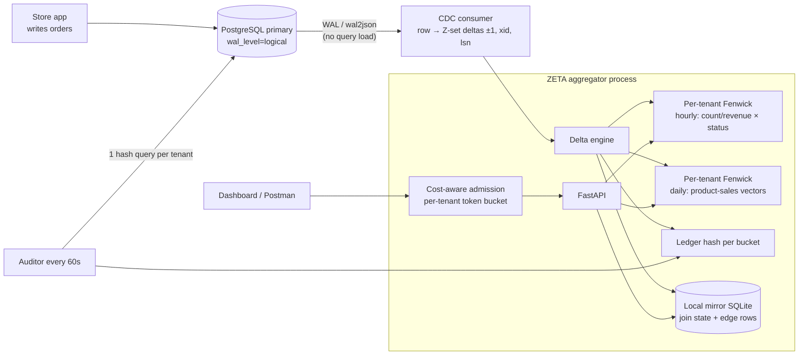

# ZETA — Z-set Exact Tenant Aggregator

**Pitch:** *Others made dashboards fast. ZETA makes them fast, live, and **provably** correct.*
Every change becomes a signed delta, every range answer is a subtraction, and the aggregator can prove that it agrees with the database.

---

## 1. Why this is different from the famous solutions

| System | Core idea | What breaks for *this* PRD |
|---|---|---|
| Uber: Pinot real-time OLAP | Columnar segments, ingest from Kafka, scan at query time | Query cost grows with data (Growth target). Upserts are bolted on. Exactness under updates is not guaranteed. |
| LinkedIn: Pinot star-tree | Pre-aggregate a cube along dimension paths | Built for append-only data. A *placed → cancelled* update needs the cube recomputed. |
| ClickHouse: incremental MVs | Insert triggers push partial aggregates | Insert-only. Updates need Replacing/CollapsingMergeTree, which only converge **at merge time**, so `FINAL` is slow or answers are temporarily wrong. |
| Typical AI-generated answer | Redis cache + cron + summary table | Stale (cron), wrong under updates (cache invalidation), and no proof of correctness. |

**ZETA's angle:** treat analytics as **algebra on an abelian group** (Z-sets, from the DBSP / Feldera incremental-computation research). Everything the PRD asks for (counts, sums, breakdowns, top-N over sales) can be built from **invertible** aggregates, so:

- updates and cancellations are exact retractions, not cache invalidations,
- any time range is answered in **O(log T)**, independent of row count,
- correctness can be **audited with one number per tenant**.

---

## 2. The four mathematical ideas

### Idea 1: Z-set deltas (exactness under updates) — FR-6
Each row change becomes a weighted fact. Weight +1 means it exists, −1 means it is retracted.
- INSERT → `+new`
- UPDATE placed→cancelled → `−old, +new` (Postgres sends the old row because of `REPLICA IDENTITY FULL`)
- DELETE → `−old`

Count and sum are **group homomorphisms**, so `agg(state + Δ) = agg(state) + agg(Δ)`. There is no recomputation and no drift.

**Joins (top products ← orders ⋈ order_items) are bilinear:**
`Δ(O ⋈ I) = ΔO ⋈ I + O ⋈ ΔI + ΔO ⋈ ΔI`.
So when an order is cancelled, ZETA looks up *that order's* items in its own join state and retracts exactly their sales.

### Idea 2: Fenwick trees over time (range queries in O(log T)) — FR-1, FR-2, FR-4, Growth
For each tenant, ZETA keeps a Fenwick tree (binary indexed tree) over **hour buckets**. Each node holds a small vector: `count[status]` and `revenue[status]` for the 5 statuses.
- Update at any hour, including old orders getting cancelled: O(log T)
- Range `[from, to)`: `prefix(to) − prefix(from)`, O(log T)
- T = 90 days × 24 = 2,160 hours, so log T ≈ 11 node reads.

**Cost depends on time span, not row count.** At 1M and 10M rows, T is the same, which covers the Growth "< 2× slower" target by construction.

**Exact edges:** `from`/`to` will rarely fall exactly on an hour boundary. The two partial hours are read from ZETA's local mirror (index on `tenant, created_at`). For the biggest tenant that is about 2k rows (sub-millisecond). Answer = Fenwick(full hours) + edge(left) + edge(right), which gives an exact match to SQL to the second.

### Idea 3: Fenwick of vectors for exact Top-N — FR-3
The same structure works with **daily** buckets, where each node is a dense vector of sales indexed by the tenant's product id (ℤ^P is also a group).
- Top-10 for any day range = `prefix(d2) − prefix(d1)`, plus edge vectors, then `argpartition(k)`.
- Largest tenant: P ≈ 5,000 products, so about 14 vector adds of length 5k → tens of microseconds.
- **Exact, no sketches.** Count-Min, SpaceSaving and HyperLogLog are approximate, which fails "matches on *all* queries". Many teams will reach for them. We explicitly don't.
- Scaling path for huge catalogs: Fagin's Threshold Algorithm over the O(log D) sorted node lists gives exact top-k by reading only list prefixes.

### Idea 4: Homomorphic Ledger Hash (provable correctness) — Correctness, B-2, B-5
Each tenant has a **multiset hash** (incremental multiset hashing, Clarke et al. 2003):

```
H_t = Σ  h(order_id | status | total_cents | created_at)   mod p,   p = 2^61 − 1
```

- **Additive**, so it updates with the same deltas: `H += h(new) − h(old)`.
- Postgres can compute the same value in one query, no export needed:
  ```sql
  SELECT tenant_id,
         sum(('x'||substr(md5(order_id||'|'||status||'|'||total_cents||'|'||extract(epoch from created_at)::bigint),1,15))::bit(60)::bigint::numeric) % 2305843009213693951
  FROM orders GROUP BY tenant_id;
  ```
- **Snapshot-exact comparison:** the audit reads `pg_current_snapshot()` (xmin:xmax:xip). ZETA tags every delta with its transaction id (xid), so it can compute its hash **at exactly that snapshot**: `H_snapshot = H_now − Σ (recent deltas whose xid is not visible in the snapshot)`. Again, subtraction does the work.
- If the hashes match, the aggregate state equals the database state (false-match probability ≈ 2⁻⁶⁰).
- Hashes are also kept **per bucket in the Fenwick tree**, so a mismatch can be binary-searched to the exact day or hour and **only that bucket is rebuilt** (surgical B-2 instead of "rebuild everything").

**Bonus from the group structure: time travel.** `?as_of=<lsn>` returns the dashboard as it was at any recent point by subtracting the later deltas.

---

## 3. Architecture



**Bootstrap without gaps or double counting:** create the replication slot with `EXPORT_SNAPSHOT`, load the base tables inside **that** snapshot (`SET TRANSACTION SNAPSHOT`), then stream from the slot. Every change is counted exactly once. Most teams get this race wrong.

---

## 4. How each requirement is met

| PRD item | ZETA mechanism | Expected result |
|---|---|---|
| FR-1 counts/totals | Hourly Fenwick + 2 exact edges | ~1–5 ms |
| FR-2 trend per hour/day | Raw bucket array slice (Fenwick's sibling array) + edge fix | ~1 ms |
| FR-3 top-N | Daily Fenwick of product vectors + argpartition | < 10 ms |
| FR-4 by status | Status is a vector dimension in the hourly node | ~1 ms |
| FR-5 tenant isolation | Physically separate per-tenant structures; tenant comes **only** from the URL and is bound to an API key; there is no shared table to filter | By construction |
| FR-6 updates | Z-set retractions (−old, +new) | Exact |
| FR-7 API | `GET /tenants/{id}/orders/count?from&to`, `/orders/trend?granularity=hour|day`, `/products/top?n=10`, `/orders/by-status` | — |
| **Speed (Great < 200 ms)** | O(log T), in memory | ~100× under target |
| **Freshness (Great < 30 s)** | Logical replication streaming | Sub-second |
| **DB safety (Great < 10%)** | Zero dashboard reads on primary; only WAL decoding plus one hash query per minute | ~1–3% |
| **Correctness (all queries)** | Exact algebra + hash audit + randomized SQL diff harness | 100%, with proof |
| **Growth (< 2×)** | Cost ∝ log(time buckets), not rows | ~1.0–1.3× |
| B-1 freshness | Every response: `as_of_lsn`, `lag_ms`, `"updated 0.4 s ago"` | ✓ |
| B-2 rebuild | Full rebuild from snapshot **or** surgical bucket rebuild located by the hash | ✓✓ |
| B-3 per-tenant limits | **Cost-aware**: ZETA knows a query's exact cost in advance (edge row counts come from its own Fenwick), and charges a per-tenant token bucket by cost, not request count | ✓ |
| B-4 config metrics | `metrics.yaml` with measure / group_by / where. The validator **rejects non-invertible aggregates** (min/max/distinct) with an explanation; avg = sum/count is derived | ✓ |
| B-5 monitoring | `/monitor`: p50/p99 latency, CDC lag, audit status per tenant (green/red) | ✓ |

---

## 5. Build plan (priority-mapped)

**P0 — must work (core of the demo)**
1. ✅ Dataset generator (`generate_data.py`): 10M orders, 100 skewed tenants, ~38 s
2. docker-compose: `postgres:16` + `wal2json`, `wal_level=logical`; the `zeta` service
3. Bootstrap from the exported snapshot → build hourly/daily Fenwicks (numpy)
4. CDC consumer (psycopg2 `LogicalReplicationConnection`, wal2json v2 with `include-xids`)
5. FastAPI: the 4 endpoints, `from`/`to` with exact edges
6. **Correctness harness:** 1,000 random (tenant, range, query) checks against direct SQL → match table

**P1 — "Great" column plus the novelty**
7. Ledger hash plus snapshot-exact audit
8. Benchmark script: latency at 1M vs 10M, freshness (insert → visible), app-query latency with and without dashboard load
9. B-1 freshness fields, B-3 cost-aware limiter

**P2 — polish**
10. B-5 `/monitor` page, B-4 `metrics.yaml`, `?as_of=` time travel, surgical rebuild demo

**Fallback if logical replication fights you:** poll `orders WHERE updated_at > watermark` (indexed) every 2 s. The delta engine is unchanged, but the old row is unknown, so keep `order_id → (status, total, created_hour)` in the mirror to produce the −old delta.

---

## 6. 3-minute judge demo
1. `docker compose up`, then `/monitor` shows 100 tenants and lag ≈ 0.3 s.
2. Query tenant 1 (2.3M orders): count, trend, top-10. Each takes a few ms.
3. Insert an order: the count goes up within 1 s. Cancel it: the count and top-10 retract exactly.
4. Run the correctness harness: 1000/1000 match direct SQL.
5. **Trick:** corrupt one bucket in memory. The audit turns red, the hash search finds the exact hour, the surgical rebuild runs, and the audit turns green again.
6. Run the growth benchmark: 1M vs 10M latency ratio ≈ 1.1×.

---

## 7. Dataset (`generate_data.py`)
- Tables: tenants, customers, products, orders, order_items (`schema.sql`, `load.sql`)
- Tenant sizes are Zipf(1.1): largest 2.3M orders, smallest 15.6k, top-3 = 41% of orders ("a few tenants are much bigger")
- 90 days of data with a growth trend, weekly pattern and evening-peak daily pattern
- Statuses consistent with order age: recent orders are placed/shipped, older ones delivered; about 8% cancelled and 5% returned
- Zipf product popularity inside each tenant, so top-10 is meaningful
- Deterministic (`--seed`); 1M/10 tenants in ~4 s, 10M/100 tenants in ~38 s, 1.4 GB of CSV

**Canonical metric definitions (both ZETA and the SQL baseline use these):**
- *Order count / revenue:* `orders` with `created_at ∈ [from, to)`, all statuses unless filtered
- *Sales for top products:* `Σ qty × price_cents` over items whose order status ∉ {cancelled, returned}
